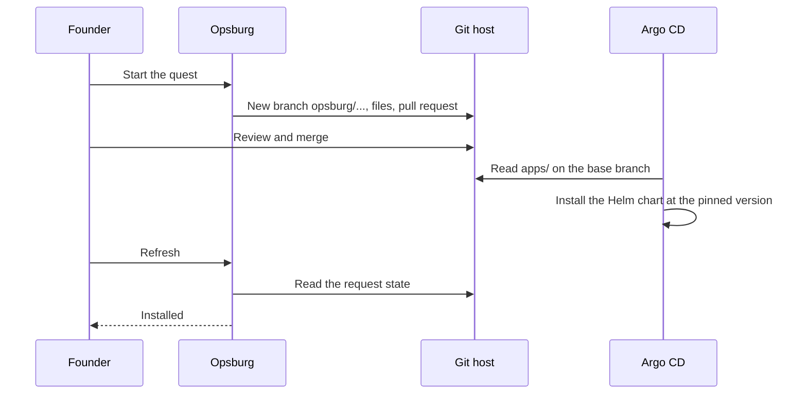

# Kubernetes clusters

The engine room of the city, that is the organization, holds its Kubernetes clusters. Opsburg never talks to a cluster's API. A cluster is a folder of a Git repository that Argo CD keeps applied: Opsburg proposes changes to that folder as pull requests (GitHub) or merge requests (GitLab), you merge them, and Argo CD installs what they describe.

Open the engine room with **Engine room · Kubernetes** on the board of a founded city.

## How it works



- Every platform component, called a cluster quest, is an Argo CD `Application` file pointing at a Helm chart at a pinned version.
- A root `Application`, the app of apps, keeps every file of the cluster's `apps/` folder in sync with the repository.
- Opsburg writes only on new branches named `opsburg/<change>-<random>`. Nothing lands on your base branch until someone merges.
- Opsburg reads nothing back from the files it writes. Each file starts with: `# Written by Opsburg. Change it through the city, or here by pull request: Opsburg reads nothing back from this file.`

## Before you start

- A [Git connection](./git-connections.md) whose token can create branches, commit and open pull or merge requests on the cluster repository.
- A repository for the cluster's GitOps files, with at least one branch. Several clusters can share a repository in different folders.
- Argo CD running in the cluster. Opsburg does not install Argo CD. See the [Argo CD getting started guide](https://argo-cd.readthedocs.io/en/stable/getting_started/).
- Argo CD able to read the repository. For a private repository, add it in Argo CD under Settings, Repositories.

## Bring a cluster

Only the founder can add clusters. Press **Bring a cluster** and fill in:

| Field | What to enter | Default |
| --- | --- | --- |
| **Name** | 2 to 48 characters, like Production, Staging, Edge. | |
| **Git connection** | The connection that reaches the repository. | The default connection |
| **Repository** | `owner/name` on GitHub, the full project path on GitLab (`acme/platform/gitops`). The field suggests the repositories of the connection. | |
| **Branch (optional)** | The branch pull requests target and Argo CD follows. | The repository's default branch |
| **Folder (optional)** | Where the cluster's files go. | `clusters/<slug>` |
| **Argo CD namespace (optional)** | Where Argo CD runs in the cluster. | `argocd` |

Press **Bring it to the city**. Opsburg checks that the repository exists, that the token can see it and that the branch exists, then saves the cluster. Nothing is written to the repository yet.

The slug is the name in lowercase letters, digits and dashes, up to 40 characters. It must be unique in the city. A city can hold up to 20 clusters.

:::note
The repository, branch, folder and Argo CD namespace cannot change after the cluster is created. To move a cluster, bring it again as a new one.
:::

## Folder layout

The first change that adds a file also adds the app of apps and a README, unless a `root.yaml` is already in the folder (then Opsburg leaves it alone).

```text
clusters/<slug>/
├── root.yaml                      # app of apps: Application opsburg-<slug>
├── README.md                      # bootstrap instructions
└── apps/
    ├── cert-manager.yaml
    ├── rancher.yaml
    ├── trivy.yaml
    ├── gateway.yaml
    ├── gateway-oci-repository.yaml  # Envoy Gateway only
    ├── letsencrypt.yaml             # ClusterIssuer, no chart
    ├── kube-green.yaml
    ├── kyverno.yaml
    ├── external-secrets.yaml
    ├── falco.yaml
    └── routes/
        └── <hostname>.yaml          # Ingress of a street
```

Only the files of the quests you start are written. The `routes/` folder holds the Ingress of each [street](./dns-registrars.md#streets-of-a-cluster).

### The app of apps

`root.yaml` is an Argo CD `Application` named `opsburg-<slug>` in the Argo CD namespace. It reads the `apps/` folder of the repository on the cluster's branch, recursively, and syncs automatically with prune and self-heal.

### A quest's Application

Each quest file is an `Application` with:

- `source.chart` and `source.repoURL` of the component, `targetRevision` set to the pinned version, and the Helm values Opsburg sets in `helm.valuesObject`;
- `destination.server: https://kubernetes.default.svc` and the component's namespace;
- automated sync with prune and self-heal, `CreateNamespace=true`, `ServerSideApply=true`, and a retry (10 attempts, 30 seconds backoff doubling up to 10 minutes) so a CRD installed by another Application can land first;
- a sync wave (cert-manager first, then the gateway, then the rest, Rancher last);
- the `resources-finalizer.argocd.argoproj.io` finalizer, so removing the file uninstalls what it installed;
- labels `app.kubernetes.io/managed-by: opsburg` and `opsburg.dev/cluster: <slug>`.

## Bootstrap Argo CD, once

After the first pull request is merged, apply the app of apps once. The cluster board shows the command under **Bootstrap Argo CD, once**, with a **Copy** button:

```sh
kubectl apply -n argocd -f clusters/<slug>/root.yaml
```

Run it from a checkout of the repository, with a kubeconfig that points at the cluster. The first pull request carries the same command in its description. From then on, merging an Opsburg pull request is what installs, changes or removes a component.

## The cluster quests

The board lists the quests in this order, then the foundations.

| Quest | Component | Helm chart | Version | Namespace |
| --- | --- | --- | --- | --- |
| Raise the ranch | Rancher | `rancher` from `https://releases.rancher.com/server-charts/stable` | 2.15.3 | `cattle-system` |
| Post the inspectors | Trivy Operator | `trivy-operator` from `https://aquasecurity.github.io/helm-charts` | 0.38.1 | `trivy-system` |
| Open the city gates | Traefik | `traefik` from `https://traefik.github.io/charts` | 42.4.0 | `traefik` |
| Open the city gates | Envoy Gateway | `gateway-helm` from `docker.io/envoyproxy` (OCI) | v1.10.0 | `envoy-gateway-system` |
| Seal the gates | Let's Encrypt | none: a `ClusterIssuer` manifest | 1.0.0 | cluster scoped |
| Bank the furnaces at night | kube-green | `kube-green` from `https://kube-green.github.io/helm-charts` | 0.7.1 | `kube-green` |
| Write the city laws | Kyverno | `kyverno` from `https://kyverno.github.io/kyverno` | 3.10.0 | `kyverno` |
| Hire the courier | External Secrets Operator | `external-secrets` from `https://charts.external-secrets.io` | 2.15.0 | `external-secrets` |
| Light the watchtowers | Falco | `falco` from `https://falcosecurity.github.io/charts` | 9.2.2 | `falco` |
| Forge the seals (foundation) | cert-manager | `cert-manager` from `https://charts.jetstack.io` | v1.21.3 | `cert-manager` |

Versions are pinned on purpose: an Application that follows the latest chart would upgrade a cluster nobody asked to upgrade. In 0.2.0 the versions are fixed by the Opsburg release.

### Options and notes

| Quest | Options | What Opsburg sets, and what to know |
| --- | --- | --- |
| Rancher | **Hostname** (required), **Ingress class** (default `traefik`) | Needs cert-manager. Rancher brings its own Ingress with its own certificate. It needs an ingress controller serving that class and the DNS of the hostname pointing at it. The first password: `kubectl get secret -n cattle-system bootstrap-secret -o go-template='{{.data.bootstrapPassword\|base64decode}}'` |
| Trivy Operator | none | Reports appear as `VulnerabilityReport` and `ConfigAuditReport` resources next to the workloads. |
| Traefik or Envoy Gateway | **Which one**: Traefik or Envoy Gateway | Traefik serves the `traefik` ingress class, not as the default class. Envoy Gateway installs the Gateway API CRDs; routes need a `GatewayClass` and a `Gateway` of your own. Opsburg also writes `gateway-oci-repository.yaml`, a repository Secret that lets Argo CD pull the chart from the OCI registry. |
| Let's Encrypt | **Email** (required), **Ingress class** (default `traefik`) | Needs cert-manager. Creates the `ClusterIssuer` named `letsencrypt` on the Let's Encrypt production ACME server, with the HTTP-01 solver on that ingress class. Hostnames must already point at the cluster's ingress. |
| kube-green | none | Needs cert-manager. Nothing sleeps until you create a `SleepInfo` in a namespace. |
| Kyverno | none | No policy is installed: add `ClusterPolicy` resources to enforce yours. |
| External Secrets Operator | none | Installs its CRDs. Create a `SecretStore` or `ClusterSecretStore` pointing at your vault, then `ExternalSecret` resources. |
| Falco | none | Runs as a DaemonSet with the modern eBPF driver: nodes need kernel 5.8 or newer. |
| cert-manager | none | Installs its CRDs with the chart. |

## Start a quest

1. On the cluster board, press **Start the quest** under a quest.
2. A quest with options or variants opens a form. Fill it in and press **Propose the install**. A quest without options opens its pull request straight away.
3. The quest shows `⧗ Install awaiting merge · request #N` with a link to the request.
4. Review and merge the request on your Git host.
5. Back on the board, press **Refresh**. The quest shows `✓ <version>`.

The request title reads `Opsburg: install <component> <version> on <cluster>`. Its description lists each component with its notes, and ends with "Close this request without merging to cancel: Opsburg notices on its next refresh."

### Foundations

cert-manager is a foundation: "Laid with the first quest that needs them." When you start Rancher, Let's Encrypt or kube-green on a cluster without cert-manager, the same pull request installs cert-manager too. You can also start it on its own.

If a required component is itself waiting in another open request, Opsburg asks you to merge or close that request first.

### Refresh

**Refresh** reads the state of every open request of the cluster:

- **Merged**: the quest is installed with what the request proposed.
- **Closed without merging**: the proposal is forgotten. A quest that was never installed leaves the board; an installed one keeps its previous version and options.
- **Open**: nothing changes.

The board refreshes once by itself when you open a cluster with requests awaiting merge. Every citizen can refresh.

## Change or abandon a quest

On an installed quest:

- **Change** (quests with options or variants) opens the form with the current values. Press **Propose the change**. The request shows `⧗ Change awaiting merge`. Proposing the same values again is refused: "It is already installed like this."
- **Abandon** asks "Remove it from the cluster?". Press **Propose removal** to open a request that deletes the quest's files. Once it is merged, Argo CD removes the Application and, through the finalizer, everything it installed.

You cannot abandon cert-manager while Rancher, Let's Encrypt or kube-green is installed or on its way: remove them first.

## Rules Opsburg enforces

- One change at a time per cluster. A second change started meanwhile gets "Another change to this cluster is under way. Try again in a moment."
- One open request per quest: "A request for it is still open: merge or close it first."
- Opsburg does not pick up hand edits. If you change a quest file in the repository yourself, the next change Opsburg proposes for that quest overwrites it.

## Forget a cluster

**Forget this cluster** asks "Forget &lt;name&gt;? The repository and what Argo CD runs stay as they are." Opsburg deletes only its own record. Close the cluster's [streets](./dns-registrars.md#streets-of-a-cluster) first: Opsburg refuses to forget a cluster while DNS records point at it.

:::tip[Where traffic comes in]
The streets of a cluster, that is its hostnames, DNS records and Ingress resources, are covered in [DNS registrars](./dns-registrars.md).
:::
