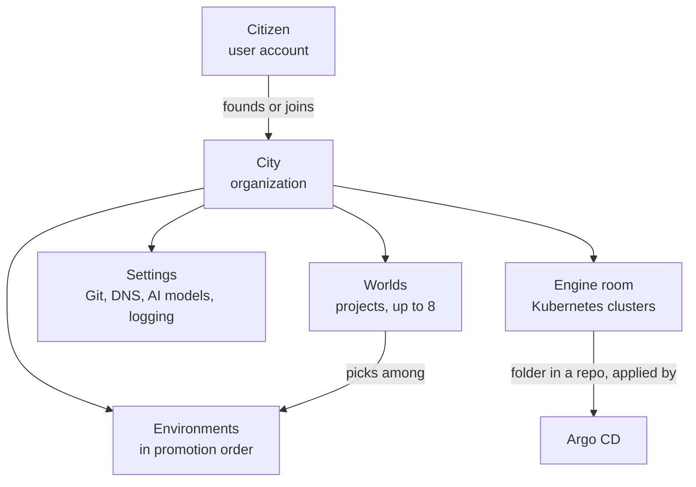
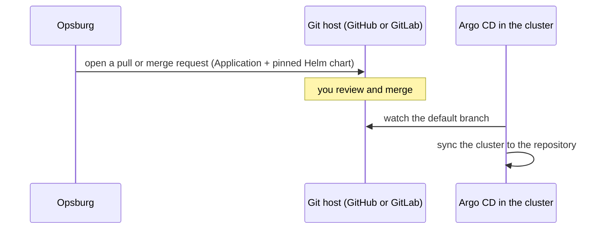

# Core concepts

Opsburg describes your platform with a small set of objects. The console draws them as a city and its surroundings, but each one is an ordinary piece of configuration stored in Opsburg's database or in a Git repository.

## The city: the organization

The city, that is the organization, is the top-level object. It holds the members, the settings and the worlds. In 0.2.0 a user belongs to one city: an account that already belongs to one cannot found another.

A city starts as a draft and becomes **founded** when its four founding quests are done (see [Quests](#quests-and-the-capital) below). Its name can change at any time, but the address derived from it (the slug) is fixed once the city is founded.

The city also keeps settings that apply to every world:

- [Git connections](./city/git-connections.md) to GitHub or GitLab.
- [DNS registrars](./city/dns-registrars.md) for Cloudflare, Route 53 or Azure DNS.
- [AI models](./city/ai-models.md) from Anthropic, Microsoft Foundry, Gemini, Azure OpenAI or Bedrock.
- [Logging rules](./city/logging.md) that resolve to `LOG_LEVEL`, `LOG_JSON` and `LOG_AUDIT` for the containers of each world.
- [Kubernetes clusters](./city/clusters.md), in the engine room.

## Worlds: the projects

A world, that is a project, floats in the sky around the city. A city holds up to eight worlds, each with a name unique within the city. Every world has one of three kinds, chosen when it is created and fixed afterwards:

| Kind (as the console names it) | Its parts are called | Parts allowed |
| --- | --- | --- |
| **One application** | Features | 1 to 8 |
| **A pool of agents** | Agents | 1 to 12 |
| **Many small applications** | Applications | 1 to 10 |

The parts describe what the world is made of (for example "Checkout" and "Search" for one application). A world can also name the Git connection that keeps its code (**Code kept in**), and it records its frontends, backends and resources. In 0.2.0 Opsburg keeps these records but does not build or deploy them: shipping a world's applications to its clusters is the direction of the project, not a feature of this release. See [Worlds](./worlds/overview.md) and [Applications](./worlds/applications.md).

Worlds can be created only in a founded city. Removing a world ("Abandon this world") deletes it with its applications and resources.

## Environments and promotion order

Environments are defined once, for the whole city, in the **Fire up the machines** quest. A city has 1 to 10 environments, each named with lowercase letters, digits and dashes (up to 24 characters). Their order in that list is the **promotion order**: the first environment gets the code first. A new city starts with `dev`, `staging` and `production`.

A world picks the environments it deploys to among the city's, and keeps the city's order. It cannot add environments of its own or reorder them. When the city removes an environment, it is taken off every world that used it.

Picking environments is the first quest of every new world, called **Lay the tracks**. All of the city's environments are selected by default. Until it is saved, the world shows nothing else and accepts no other change; only deleting it is allowed. See [Environments](./worlds/environments.md).

## Quests and the capital

Setup work in Opsburg is presented as quests. A quest is a form that saves one section of configuration; once saved, it is marked done and you can open it again to change it.

The city has four **founding quests**. The first creates the organization; the other three unlock after it and can be done in any order. Each completed quest raises part of the capital, the city at the center of the scene:

| Quest | What it saves | What it raises |
| --- | --- | --- |
| **Charter the city** | Name, what the organization does, what the AI should know | The town hall |
| **Paint the rooftops** | Color palette and design system | The houses, in your colors |
| **Fire up the machines** | Clouds, runtime, CI tools, environments | The works and the environment islands |
| **Call the citizens** | Invitations by one-time link | The square and its lights |

**Side quests** are optional and never hold back the founding. In 0.2.0 there is one: **Keep the logbooks**, the logging rules. Worlds have their own first quest (the environments), and clusters have quests too: the platform components you can install on them. See [Founding the city](./city/founding-the-city.md).

## The citizen

Each user is a citizen of Opsburg. After signing up, a new user dresses their citizen in [the atelier](./account/atelier.md) before entering the city, and the citizen then stands on a landing in front of the city with the user's name above it. The citizen is only a look: it has no effect on permissions.

## Roles and ownership

Opsburg 0.2.0 has two roles in a city, and the backend enforces them on every request:

| Role | Shown as | Who | What they can do |
| --- | --- | --- | --- |
| `owner` | Founder | The user who completed the first founding quest | Everything: the quests, the worlds and their environments, Git connections, clusters and their quests, DNS registrars, AI models, logging rules, invitations |
| `member` | Citizen | A user who accepted an invitation link | See the city, its worlds and its clusters, and refresh the status of cluster changes. They cannot change them. |

A city has one founder. There are no per-world roles, no custom roles and no installation-wide administrator in 0.2.0. Invitations are one-time links, valid for 14 days; whoever holds a link can accept it, whatever email it was sent to. See [Members and invitations](./city/members-and-invitations.md).

## How GitOps fits

Opsburg never connects to a Kubernetes cluster and holds no cluster credentials. A cluster in Opsburg is a **folder of a Git repository**, reached through one of the city's Git connections, that Argo CD running in the cluster keeps applied.

The folder holds a `root.yaml`, a `README.md` and an `apps/` directory:

- `root.yaml` is an **app of apps**: an Argo CD Application you apply once by hand with `kubectl apply`. From then on it keeps every Application under `apps/` in sync with the repository, with automated prune and self-heal.
- Each platform component you add (a cluster quest such as cert-manager, Traefik or Kyverno) is an Argo CD Application under `apps/`, pointing at the component's Helm chart at a **pinned version**. Opsburg proposes it as a pull request on GitHub or a merge request on GitLab, and the cluster changes only after you merge it.
- Each street, a hostname pointed at the cluster's ingress, gets its DNS record at a registrar and, when it routes to a service, an Ingress proposed the same way.

Because every change is a commit, the repository is the record of what each cluster runs, and your usual review rules on that repository apply. See [Clusters](./city/clusters.md).
